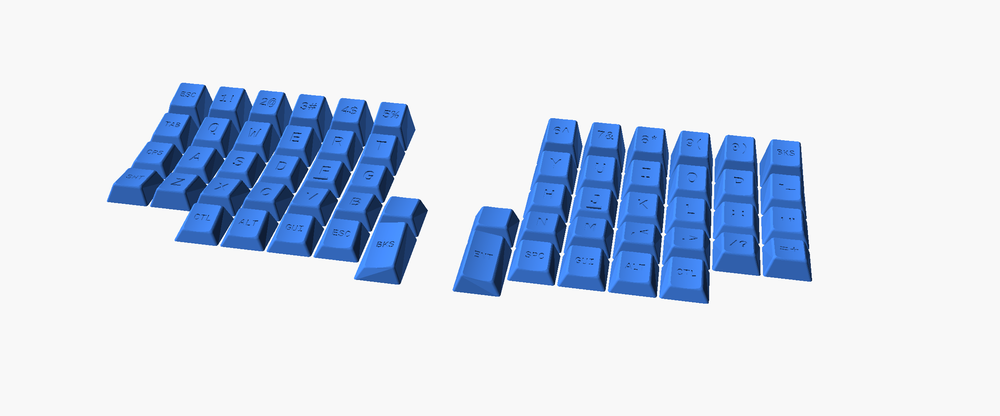
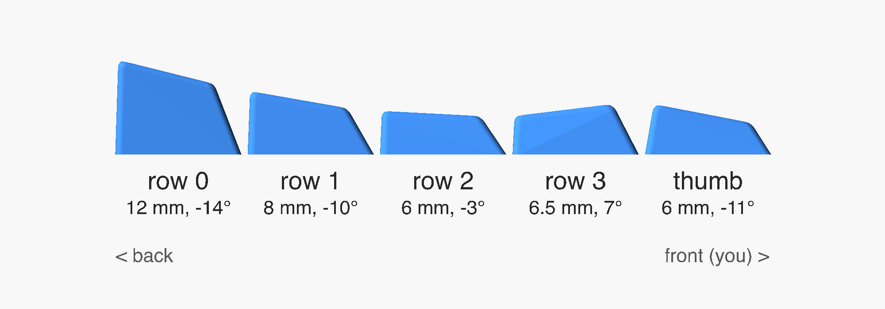

# OpenSCAD Sofle split keyboard keycaps

OpenSCAD model for a custom keycap profile, with a complete set for the
Sofle split keyboard. This project is a modification of
[KeyV2](https://github.com/rsheldiii/KeyV2).

The keycap profile is a modification of DCS by Signature Plastics. The main
changes are the row heights and angles, and the bevelled top edges.

## Files

### `profile.scad`: the profile and shared settings

Everything here applies to the single key and to every layout at once.

- **Profile per row** (`heights`, `tilts`, `skews`, `fontSizes`): one value
  per row, from row 0 (number row) to row 4 (thumb keys).
- **Bevelled top edge** (`top_bevel`, `top_bevel_steps`): the width of the
  bevel in mm, and its shape (1 = straight chamfer, 4 or more = rounded).
- **Homing bumps** (`home_keys`, `bump_depth`, `bump_edge`): which keys get a
  bump and what it looks like.
- **Print settings** (`stem_slop`, `stem_tines`, `stem_tine_width`,
  `stem_tine_height`): stem fit, and thin lines on the first layer that hold
  the stem in place while printing. Snip them off afterwards.

### `key.scad`: a single key

For testing settings or printing a spare keycap. At the top you set the
legend, row, length (in units) and sideways tilt, and whether it gets a
homing bump.

### `layouts/sofle.scad`: the full Sofle set

The legends for both halves, the size and tilt of the separate thumb keys,
and `half` to render only the left half, only the right half, or both.

### `images/`

`sofle-set.scad` renders the image of the full set at the top, and
`profile-side.scad` the side view of the rows. The command to regenerate each
image is at the top of its file.

### `src/`: the underlying code

The keycap generator itself. You normally don't need to change anything
here.

## Usage

Open `key.scad` or `layouts/sofle.scad` in OpenSCAD, adjust the values at the
top, render with F6 and export as STL. To change the shape of all keys, edit
`profile.scad`. Note that the OpenSCAD Customizer only shows the settings of
the file you opened, so profile settings don't appear there.

## License

Like KeyV2, this project is licensed under the GNU General Public License v3.0.
See `LICENSE.md` for the full text.
